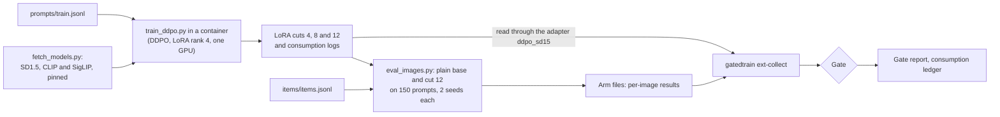

# gatedtrain recipe: SD1.5 DDPO + LoRA (JPEG compressibility)

This recipe teaches Stable Diffusion 1.5 to draw images that compress better as JPEG, and lets
[gatedtrain](https://github.com/gatedtrain/gatedtrain) decide whether that gain holds up on a different measure. A port
of DDPO (kvablack/ddpo-pytorch) on diffusers and peft trains a LoRA (rank 4) with a JPEG-compressibility reward on
ImageNet animal-class prompts, on one GPU (RTX 4090). gatedtrain then gates the last LoRA cut against the plain base on
150 held-out prompts (two seeds each) with a lossless-WebP size metric, a different codec from the reward's, by a rule
registered before training.

A recipe is a ready-made external run for gatedtrain: the training code with its locked environment, plus an
*adapter*, the small plugin through which gatedtrain reads the run's outputs. gatedtrain does not start the training;
you run it.

This is a prototype: the result below is one registered run, not a benchmark claim.

## How it works



`gatedtrain ext-launch` checks the run request and prints the container command; you run it. The steps, flags and
arm files are explained in gatedtrain's [External runs](https://gatedtrain.github.io/gatedtrain/external-runs/) guide.

## Result

One registered run: 12 epochs of 64 samples (768 samples; cuts 4, 8 and 12), 0.41 GPU-hours on one RTX 4090.

| | `webp_lossless_bpp` on 150 prompts x 2 seeds (lower is better) |
|---|---|
| Baseline (SD1.5) | 9.811 bpp |
| Candidate (cut 12) | 9.382 bpp |
| Gate | **PASS** under the original registration; **INCONCLUSIVE (post_hoc)** under the registration amended for the renames: improvement 0.4288 bpp, 95% cluster-bootstrap interval [0.3748, 0.4859], p <= 6.2e-05 |

The amendment is post hoc: the scorer the registration pins had changed after the gate, in a cleanup before publication, so the amendment also carries a new evaluator identity.

The achieved power is 0.567 at the declared minimum detectable effect of 0.06, and the report marks it
`underpowered`; the interval is far from 0, so the pass stands. The deciding metric is construct-aligned with the
reward: a pass shows that the reward's gain transfers to another codec, not that the images are better.

`RESULT.md` has the full record: the registration, power, the SigLIP constraint, overlap with training, the impact
query and the re-collection with this repository's adapter. The gate files are under `results/2026-11-13/`.

## Setup

```bash
pip install "gatedtrain @ git+https://github.com/gatedtrain/gatedtrain@v0.3.0"   # the framework, at the release this recipe was tested with
pip install -e .                      # the adapter, into the environment that runs gatedtrain
cd runtime && uv sync --frozen        # the training and evaluation environment (diffusers, peft, torch)
.venv/bin/python fetch_models.py      # SD1.5, CLIP ViT-L/14 and SigLIP weights at the pinned revisions (git-ignored)
```

The aesthetic MLP head (a descriptive sub-metric only) is converted from the ddpo-pytorch asset with
`fetch_models.py --aesthetic-from <path>`. The adapter finds the runtime at `runtime/` of this checkout, located from
its own source tree, so a non-editable install (a wheel) must set `GATEDTRAIN_RECIPE_DDPO_SD15_RUNTIME` to the
runtime directory. It reads the interpreter tree from `runtime/.venv/pyvenv.cfg`; the training and
evaluation runs' outputs go under the host's gatedtrain output root (`<output_root>/ddpo-sd15`). `runtime/README.md` has the
commands, mounts, profiles and the decisions behind the metrics.

Trust: `fetch_models.py --aesthetic-from` unpickles the aesthetic-predictor `.pth` (with `torch.load(weights_only=True)`,
after checking its SHA-256); the LoRA cuts are safetensors. Load only checkpoints and model files you produced or
verified against the pinned hashes.

## Layout

| Path | What |
|---|---|
| `src/gatedtrain_recipe_ddpo_sd15/` | the gatedtrain adapter `ddpo_sd15` (`adapter.py`, built on gatedtrain's `gatedtrain.families.diffusers_lora.DiffusersLoraAdapter`) and its registry rows (`rows.py`), registered through the `gatedtrain.adapters` entry point |
| `runtime/` | what runs in the container: `train_ddpo.py` (the DDPO port), `eval_images.py` (the image evaluator: WebP lossless bpp, JPEG q95 kB, the SigLIP constraint), `fetch_models.py`, the training prompts (`prompts/`), the registered item set (`items/`), the constraint set, the model pins (`models/MODELS.json`), and its own `pyproject.toml` and `uv.lock` |
| `tests/` | the adapter's tests on fixture runs (no GPU, no model weights needed) and gatedtrain's conformance check |
| `results/2026-11-13/` | the gate files of the published result (redacted copies: host paths replaced by placeholders; see `RESULT.md`) |

## Tests

```bash
python -m unittest discover -s tests -t tests
```

Code comments, tests and `RESULT.md` cite records of the framework's development: its review rounds ("review round
8", "review 9 L2") and ids of its internal issue lists (`G-21`). Those records are not published; the decisions this
recipe depends on are recorded in `runtime/README.md` "Decisions taken".

## Data and licenses

| What | Source | License | In this repository |
|---|---|---|---|
| Stable Diffusion 1.5 (the base model) | `stable-diffusion-v1-5/stable-diffusion-v1-5` @ `451f4fe16113bff5a5d2269ed5ad43b0592e9a14` (the mirror of the original `runwayml/stable-diffusion-v1-5` release) | CreativeML OpenRAIL-M (model card), including its use restrictions | no: `fetch_models.py` downloads it |
| SigLIP so400m (the constraint check) | `google/siglip-so400m-patch14-384` @ `9fdffc58afc957d1a03a25b10dba0329ab15c2a3` | Apache-2.0 (model card) | no |
| CLIP ViT-L/14 (backbone of the aesthetic sub-metric) | `openai/clip-vit-large-patch14` @ `32bd64288804d66eefd0ccbe215aa642df71cc41` | the Hugging Face model card declares no license; the openai/CLIP code repository is MIT | no |
| LAION improved aesthetic predictor head (a descriptive sub-metric) | `sac+logos+ava1-l14-linearMSE.pth` from christophschuhmann/improved-aesthetic-predictor, as shipped in kvablack/ddpo-pytorch @ `1958463f` | Apache-2.0 (improved-aesthetic-predictor); MIT (ddpo-pytorch) | no: only `runtime/models/aesthetic-mlp/SOURCE.json` |
| ImageNet class names (prompts and items) | `runtime/data-source/imagenet_classes.txt`, copied from kvablack/ddpo-pytorch @ `1958463f`; the ILSVRC-2012 class labels | MIT (ddpo-pytorch; `THIRD_PARTY_NOTICES.md`) | yes, with the derived `runtime/prompts/train.jsonl` and `runtime/items/items.jsonl` |
| DDPO algorithm | kvablack/ddpo-pytorch @ `1958463f020112c9a7bc85768d296daacc2e1b4b` | MIT | ported in `runtime/train_ddpo.py` and `runtime/eval_images.py` (`THIRD_PARTY_NOTICES.md`) |
| CUDA base image | `docker.io/nvidia/cuda:13.0.3-devel-ubuntu24.04@sha256:b7ae301dea2c162444795462ce17a05f6a516e5a75944b57af5b88540a1a2266` | NVIDIA Deep Learning Container License (the image's Docker Hub page) | no: pulled at launch |
| Python packages of the runtime | `runtime/uv.lock` | each package's own license | no: installed by `uv sync` |

## Responsible use

This recipe fine-tunes and samples Stable Diffusion 1.5, a text-to-image model. Use it, and anything trained with it,
only with care:

- Do not use it to create content that is illegal, infringes others' rights, harasses or demeans people, depicts real
  people without their consent, or is meant to deceive (for example fabricated news or evidence).
- Label generated images as synthetic wherever they are published or shared.
- Follow the use restrictions of the CreativeML OpenRAIL-M license of the base model (its use-based restrictions,
  paragraph 5 and Attachment A). They also bind derivatives such as a LoRA trained with this recipe: whoever
  distributes one must pass those restrictions on to its users (paragraph 4).
- The scripts load the pipeline without its safety checker (`"safety_checker": None` in `runtime/train_ddpo.py` and
  `runtime/eval_images.py`), because the reward and the gate score raw samples. Nothing filters what the model
  generates; add your own filtering before showing generated images to anyone.
- Comply with the laws that apply to synthetic media where you use it.

## License

Apache License 2.0 (`LICENSE`); attribution notice in `NOTICE`. Ported code and copied data, with their licenses
(kvablack/ddpo-pytorch, MIT; huggingface/diffusers, Apache-2.0): `THIRD_PARTY_NOTICES.md`. Model weights, datasets and
the container image are not part of this repository and keep their own licenses ("Data and licenses" above).

Names of third-party projects and products are trademarks of their owners; this project is not affiliated with or
endorsed by them.
